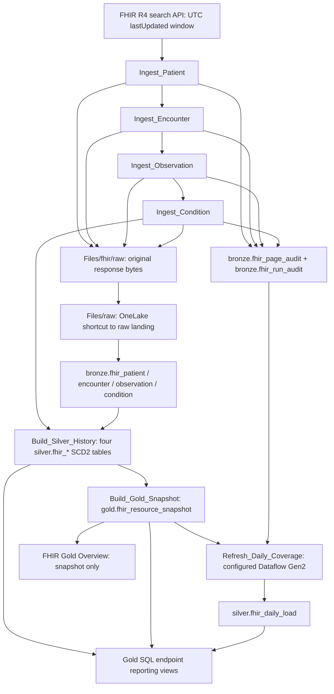
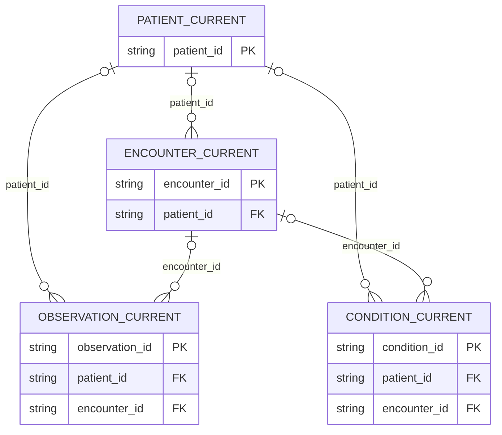

# Architecture and Validation

## Project structure

| Asset | Files | Purpose |
| --- | --- | --- |
| Source code | [fhir_extract.py](fhir_extract.py), [fhir_delta.py](fhir_delta.py) | HTTP ingestion, pagination, raw landing, Delta merges, SCD2, Gold snapshot |
| Notebook generator | [build.py](build.py) | Rebuilds the portable notebooks and six-activity pipeline from source |
| Bronze notebook | [FHIR_Ingest.ipynb](notebooks/Bronze/FHIR_Ingest.ipynb) | Parameterized ingestion for one resource type |
| Silver notebook | [FHIR_Silver.ipynb](notebooks/Silver/FHIR_Silver.ipynb) | Rebuilds observed business-change history |
| Gold notebook | [FHIR_Gold.ipynb](notebooks/Gold/FHIR_Gold.ipynb) | Publishes resource counts and freshness |
| Pipeline setup | [pipeline-content.json](pipeline/pipeline-content.json), [make_create_request.py](pipeline/make_create_request.py) | Portable definition and UUID substitution/request-body helper |
| Dataflow transform | [daily_ingestion_coverage.pq](dataflow/daily_ingestion_coverage.pq) | Daily successful-load coverage; destination must be configured in Fabric |
| SQL | [gold_views.sql](sql/gold_views.sql), [validate.sql](sql/validate.sql) | Six reporting views and quality checks |
| Tests | [test_ingestion.py](tests/test_ingestion.py), [local_delta.py](tests/local_delta.py) | Offline unit tests and optional Spark/Delta regression |
| Historical evidence | [validation_counts.csv](validation_counts.csv) | Aggregate counts for the original two-day validation, not current totals |
| Deployment guide | [README.md](README.md) | Capacity, Lakehouse, shortcut, notebook, pipeline and Dataflow setup |

The source definitions support deployment to another Fabric workspace. Workspace
IDs, notebook IDs, Lakehouse bindings, and Dataflow connections must be configured
for the target environment. Patient records, raw responses, credentials, and
notebook execution outputs are not stored in the repository.

## Pipeline and data lineage



The JSON definition has **six Notebook activities**, linked by successful
completion, with one retry and a 30-second retry interval. It intentionally has
placeholder IDs. Import the notebooks first, bind their default Lakehouse, then
render the request with the helper described in [README.md](README.md).

The optional seventh activity, Dataflow refresh, is **not in the portable JSON**.
Create the Dataflow, configure its connection and Replace destination, then add
the activity after Gold. Without this step, the daily-load table and its reporting
view will not be available. Run SQL view creation after the tables synchronize;
create the daily-load view only after its destination exists.

All four ingestion activities receive the same dates, pipeline RunId and trigger
time. Explicit start dates are inclusive; end dates are exclusive. Blank date
bounds select the preceding complete UTC days. Run the pipeline serially:
Silver and Gold overwrite shared derived tables.

## Table grains, keys and relationships

| Object | Grain / logical key | Parent or source |
| --- | --- | --- |
| Raw JSON pages | Resource, source date, run, attempt, page number | FHIR search response |
| `bronze.fhir_page_audit` | `(attempt_id, page_number)` | Exact request URL and raw file path |
| `bronze.fhir_run_audit` | `(resource_type, source_date, run_id, started_timestamp)` | Completion/failure of a resource-day attempt |
| Four `bronze.fhir_*` tables | Canonical resource event, deduplicated by `event_id` within each table | Matching entries in raw pages |
| Four `silver.fhir_*` tables | Business-change version; `(resource_id, valid_from)` within each table | Corresponding Bronze history |
| `gold.vw_fhir_patient` | One current row per `patient_id` | Current Silver Patient |
| `gold.vw_fhir_encounter` | One current row per `encounter_id` | Current Silver Encounter; optional Patient |
| `gold.vw_fhir_observation` | One current row per `observation_id` | Current Silver Observation; optional Patient and Encounter |
| `gold.vw_fhir_condition` | One current row per `condition_id` | Current Silver Condition; optional Patient and Encounter |
| `silver.fhir_daily_load` / `gold.vw_fhir_daily_load` | `(resource_type, source_date)` for the latest successful attempt | Dataflow joins page and successful run audits |
| `gold.fhir_resource_snapshot` / `gold.vw_fhir_resource_snapshot` | One row per `resource_type` | Counts and timestamp maxima over Silver |

The clinical relationships below apply to the **current Gold views**, not to
unfiltered SCD2 history. They are logical joins, not enforced SQL foreign keys.



- `subject.reference` supplies `patient_id`; `encounter.reference` supplies
  `encounter_id`. Relative references and absolute references under the configured
  API base are normalized; optional `/_history/<version>` suffixes are supported.
- A date-window extract is not a full clinical population. Parent records can be
  absent. Views use left joins and expose `patient_in_sample` and, where applicable,
  `encounter_in_sample`; they do not discard unmatched children.
- Never join full Silver histories using `resource_id` alone: multiple versions
  can multiply rows. Filter `is_current = 1`, or use an explicit as-of interval
  `valid_from <= timestamp < valid_to`, treating a null end as open-ended.
- Bronze retains metadata-only events; Silver only creates a new interval when
  the business content hash changes. `valid_to` is exclusive and each observed
  resource has one current row. FHIR search does not recover missed intermediate
  versions or deletions.
- Audit joins use `(resource_type, source_date, run_id, attempt_id)`. Daily coverage
  selects the latest successful complete attempt, not the sum of all retries.
- Snapshot counts and daily activity have different grains. Do not join the
  snapshot to clinical rows or sum it after a one-to-many join.

## Power BI report

- [Fabric workspace](https://app.fabric.microsoft.com/groups/b6659a9d-9437-4334-80d8-b2e649a22ab9/list?experience=fabric-developer)
- [Saved one-page FHIR Gold Overview report](https://app.fabric.microsoft.com/groups/b6659a9d-9437-4334-80d8-b2e649a22ab9/reports/a6843707-cdfe-4edf-9d47-cf7bd9e7f12f/b646f14a64700705d319?experience=fabric-developer)
- Semantic model: **FHIR Gold Analytics**, Direct Lake over
  `gold.fhir_resource_snapshot` only. It has no clinical-table relationships.

The page contains categorized resource-count cards, a count-by-resource bar
chart, a composition donut and a counts/freshness table. Cards show separate entity
counts. The snapshot checked during report validation contained:

| Resource | Current resources |
| --- | ---: |
| Patient | 1,398 |
| Encounter | 641 |
| Observation | 65,997 |
| Condition | 13,338 |
| Total | 81,374 |

These counts change when the source is refreshed. They are separate from the
7,180-event integration validation window.

Model measures:

```dax
Current Resources = SUM('fhir_resource_snapshot'[current_resources])
Observed Versions = SUM('fhir_resource_snapshot'[observed_versions])
Resource Types = DISTINCTCOUNT('fhir_resource_snapshot'[resource_type])
Resource Count Display = FORMAT([Current Resources], "#,0")
```

Use the text display measure only for exact-count cards categorized by
`resource_type`; use the numeric measure for charts and aggregation. The duplicate
Observed Versions measure is available in the model but is not repeated in the
report table.

The report is a resource overview over the Gold snapshot, not a multi-table
clinical analysis. Opening the live report requires workspace permission.
PBIX/PBIP and semantic-model definition exports are not included. The six SQL
reporting views are defined in [gold_views.sql](sql/gold_views.sql).

## Validation and reproducibility

From the project root on Windows, the offline tests require only Python 3.10+
and the standard library:

```powershell
python -m unittest discover -s tests -p "test_*.py" -v
```

For intentional regeneration of the portable assets:

```powershell
python build.py
```

Regeneration overwrites the three local notebooks and pipeline JSON. Preserve
any manual changes first; it does not deploy to Fabric.

The optional integration regression in [tests/local_delta.py](tests/local_delta.py)
requires a working Spark/JVM environment, PySpark 3.5.3 and Delta Lake 3.2.1.
Set `DELTA_JARS` to the required local Delta Spark and Delta storage JAR paths
(comma-separated) and put the project root on `PYTHONPATH` before running
`python tests\local_delta.py`. Fabric supplies its own Spark/Delta runtime for
the deployed notebooks. The optional live mode requires external raw fixtures;
they are intentionally not distributed.

Source checks cover the five offline tests, Python and notebook-cell syntax,
generated-asset consistency, and pipeline activity order and parameter mappings.
All five offline tests also passed against the published repository contents.
Run the Fabric pipeline and SQL validation again after deployment to a new
environment; local tests do not validate workspace permissions or connections.
